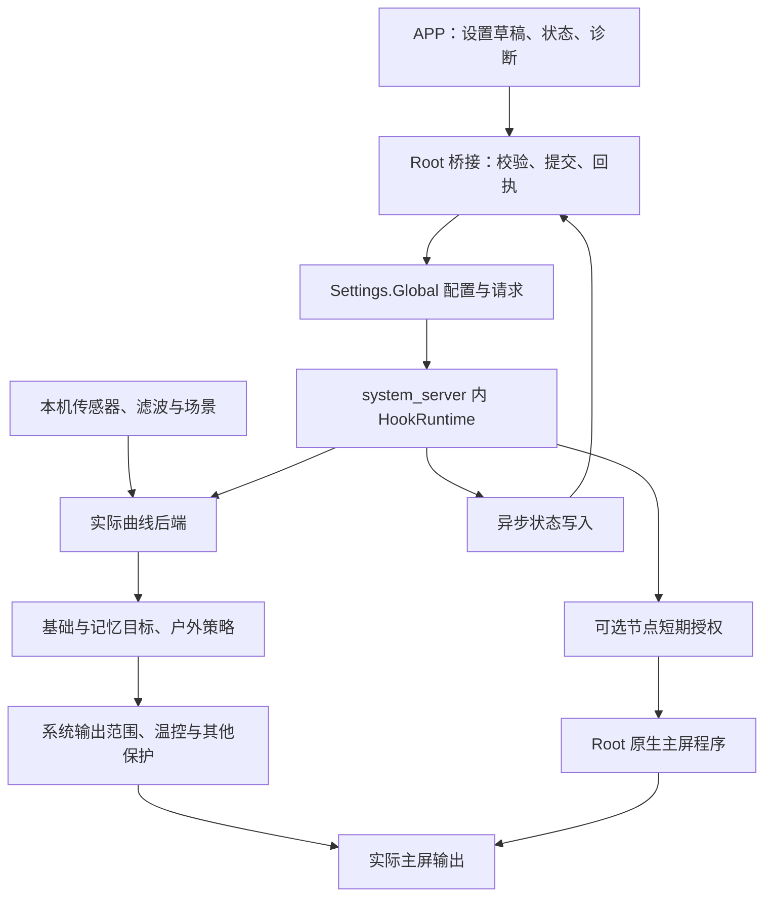

# HyperLux 项目文档

2026-10-22 同版本修订发布：**4.1.0 / 41000 / release-4.1.0-r1**。用户明确要求修复更新弹窗底部按钮截断并降低高度后原版本重推。独立预留标题和两排按钮，仅日志滚动；常规高度限制为安全可用范围82%，短日志不强占空间。版本名称、版本代码、原签名与保存设置不变；同版本已安装用户须手动下载覆盖。旧包不覆盖，新包位于 dist/HyperLux-4.1.0-r1/；按授权同步GitHub、LSPosed与官网，审计在私有 build/release-4.1.0-r1-publish/。下方为初发及历史记录。

2026-10-22 当前正式交付：**4.1.0 / 41000 / release-4.1.0**。用户明确授权将 Beta 01—08 的最终实现正式打包，并同步 GitHub、LSPosed 与官网；覆盖下方旧阶段的仅本地限制。更新说明以公开 4.0.2 / 40200 为基线，顶部写用户功能、机型适配和体验改善，技术细节置于下方。保留全部已有兼容、用户设置和历史交付包；不合入 API 102 或独立研究，不主动安装或操作手机。完整日志见 docs/releases/4.1.0.md，复审见 docs/reviews/review-4.1.0.md；最终构建与三渠道下载核验回执保存在私有 build/release-4.1.0-publish/。下方为历史过程，不覆盖此次明确发布授权。

2026-10-22 当前交付目标：**4.0.2 Beta 08 / 40208 / beta-4.0.2-beta08**。邀请弹窗按用户指定简化为28sp大标题“试试快速设置”和18sp说明“回答6个简单的问题让亮度更符合你的习惯”，删除数字、主题及底部灰字，只保留原有操作按钮；并移除设置首页“引擎控制”标题，保留操作与未保存提示。问答、预设、邀请规则、原配置和兼容路线不变。继续递增Beta本地打包，保留Beta 07及全部旧包，不发布、不部署、不安装。日志从正式4.0.2累计、按Beta 01—08分段；见 docs/releases/4.0.2-beta08.md、docs/reviews/review-4.0.2-beta08.md，审计在 build/beta-4.0.2-beta08/。下方旧阶段不覆盖本轮。

2026-10-22 当前交付目标：**4.0.2 Beta 07 / 40207 / beta-4.0.2-beta07**。按用户最新要求简化快速设置：问题、描述与选项左对齐，选项降低最小高度，删除顶栏退出；每页底部保留取消，不选直接下一步即不改该项，取消显式保留选项；确认页合为单张六项清单。点击快速设置入口始终先弹邀请，确认才进入，自动首次邀请仍只一次。底部提示为“不选择将不会进行修改”。原预设与配置 / 兼容规则保留，沿继续递增Beta要求本地打包，保留Beta 06及旧包，不发布、不部署、不安装。累计日志基线为正式4.0.2并按Beta 01—07分段。见 docs/releases/4.0.2-beta07.md、docs/reviews/review-4.0.2-beta07.md，审计在 build/beta-4.0.2-beta07/。下方旧阶段不覆盖本轮。

2026-10-22 当前交付目标：**4.0.2 Beta 06 / 40206 / beta-4.0.2-beta06**。按用户截图重排快速设置：问题和说明居中、独立选项标题及描述、对称单选卡片、底部提示居中、内容区均衡留白；放大首次邀请及关键信息，按钮随字体换行等高，沿用实际窗口与安全边距限制。功能、预设、已有配置和兼容路线不变。沿用户继续递增 Beta 的要求本地打包，保留已交付 Beta 05及所有旧包，不发布、不部署、不安装。日志从正式4.0.2累计并按Beta 01—06分段。见 docs/releases/4.0.2-beta06.md、docs/reviews/review-4.0.2-beta06.md，审计在 build/beta-4.0.2-beta06/。下方旧阶段不覆盖本轮。

2026-10-22 当前交付目标：**4.0.2 Beta 05 / 40205 / beta-4.0.2-beta05**，用户要求快速设置完成后继续递增 Beta 并本地打包。包含 Beta 04 全部兼容修复及六题可选快速设置、首次邀请、汇总确认与最新设备状态复核；全部旧兼容和用户保存设置保留。累计日志以已公开 4.0.2 / 40200 为基线，按 Beta 01—05 分段。仅本地原签名打包，不发布、不部署、不安装，保留所有已交付 APK / ZIP。见 docs/releases/4.0.2-beta05.md、docs/reviews/review-4.0.2-beta05.md，审计在 build/beta-4.0.2-beta05/。此要求覆盖下方仅源码阶段，历史发布授权不适用于新 Beta。

2026-10-22 当前任务：在已交付 4.0.2 Beta 04 基础上新增可选快速设置。设置首页在“光感输入与场景”上方提供入口，六个单选页面组合本机现有预设，最后汇总确认；首次进入设置页邀请一次，答题或取消不改配置。新开关均由用户明确选择，全部保留选项不提交；其余已有设置及兼容路线保留。此轮仅源码实现和完整验证，未要求新包，不替换 Beta 04 交付物，不发布、不部署、不安装。说明及验收见 docs/guides/quick-setup.md、docs/reviews/review-quick-setup-20261022.md。下方历史版本授权不覆盖此轮。

2026-10-22 当前交付目标：**4.0.2 Beta 04 / 40204 / beta-4.0.2-beta04**，用户明确要求修复并本地打包；不发布、不部署、不安装。新增户外专用独立自动对象 / 双亮度原因识别与折叠物理租约协作路径，保留原生策略、普通主屏节点、手动面板和所有已保存设置；切屏只在新物理身份及唯一 DSI 一致后重新确认，继续退让系统保护。日志从公开 4.0.2 / 40200 累计，按 Beta 01—04 分段。见 docs/releases/4.0.2-beta04.md 与 docs/reviews/review-4.0.2-beta04.md；私有审计在 build/beta-4.0.2-beta04/。下方只分析阶段和历史授权不覆盖此次修复 / 打包要求。

2026-10-21 当前交付目标：**4.0.2 Beta 03 / 40203 / beta-4.0.2-beta03**，用户明确要求本地打包；不发布、不部署、不安装。合入 MIX Fold 3 的独立显示端口节点绑定与传统三参过渡兼容，更新弹窗单一加高日志区、底部双行并排操作，暗光稳定放在暗光锁定上方。全部原有路线及用户保存设置保留。私有诊断包改按机型归档，版本作为索引元数据，目录连接保持旧测试路径。见 docs/releases/4.0.2-beta03.md、docs/reviews/review-4.0.2-beta03.md 和专项复审；构建审计在私有 build/beta-4.0.2-beta03/。下方仅源码阶段与旧发布记录不覆盖本次打包授权。

2026-10-21 当前任务：小米 MIX Fold 3 分析与本地源码兼容修复，未重新打包、发布或安装。实际分析包为 release-4.0.2 / OS3.0.304.0；新增显示端口与内核编号独立的唯一活动 DSI 绑定、传统过渡三参入口，修正原生关闭场景的自检分类。所有旧路径与已保存设置保留。132 条完整 PASS 汇总，268 份既有 APK / ZIP 字节不变。当前源码包含尚未打包修复，已交付 Beta 02 不包含本次内容。详见 docs/reviews/review-mix-fold3-20261021.md；私有证据 build/fold3-f26a8d/。下方旧交付和发布记录不覆盖本轮。

2026-10-20 当前任务：**4.0.2 Beta 02 / 40202 / beta-4.0.2-beta02**。修复 Beta 01 的折叠主屏面板回归：实际系统使用 StablePhysical，之前仅识别 Physical 而误拒绝内外屏。保留旧地址分支，新增独立稳定地址分支和真实端口读取，不从稳定物理 ID 推导端口；增补真实默认屏反射入口与负向回归。仅本地修复、完整验证和 Beta 打包，不推送、不部署、不安装；保留正式版、Beta 01 与全部用户设置。见 docs/releases/4.0.2-beta02.md、docs/reviews/review-4.0.2-beta02.md，私有证据 build/fold-panel-6a5ef1/。下方旧任务不覆盖本轮。

2026-10-20 当前任务：**4.0.2 Beta 01 / 40201 / beta-4.0.2-beta01**，修复折叠用户主屏节点面板只能调内屏。仅本地修复、完整验证及 Beta 打包交付，不替换正式 4.0.2，不推 GitHub / LSPosed / 官网，不操作手机。新增实际折叠布局与当前默认物理屏绑定路线，保留旧直屏 / LED / 户外 / 隐藏映射路径与全部用户设置；切屏结束旧接管，不跨屏延用节点值。依据与边界见 docs/reviews/review-4.0.2-beta01.md；私有输入位于 build/fold-panel-0f42c0/。下方旧发布授权不适用于此 Beta。

2026-10-20 当前有效任务：用户明确要求正式发布 **4.0.2 / 40200 / release-4.0.2**，覆盖此前 Beta 仅本地的限制。合入 4.0.1 Beta 01 / 02，更新说明严格采用用户给定三条；补充网站感谢名单“番茄沙司：亮度真好用”，名单不写入版本更新日志。保留全部既有路线与用户设置，默认主动增强不变。完成完整回归、原签名与源码一致性检查后同步 GitHub、LSPosed 和官网，逐渠道下载核对；不自动安装手机。发布回执在私有 build/release-4.0.2-publish/。下方旧阶段记录不覆盖本次授权。

2026-10-20 当前任务：**4.0.1 Beta 02 / 40102 / beta-4.0.1-beta02**。仅本地实现、验证和打包，不推送、不部署、不安装手机。沿用 Beta 01 的单主光感与传统过渡兼容；“睡前保持”更名“暗处保持”，新增默认不启用的日落后暗光锁定预设与独立夜间范围开关。复用实际系统日出日落服务，仍需满足照度确认，日出只释放本模块持有的锁定；无有效时间等待，不猜固定钟点，不影响全天方案和已有设置。见 docs/releases/4.0.1-beta02.md 与 docs/reviews/review-4.0.1-beta02.md；私有核验在 build/beta-4.0.1-beta02/。下方旧阶段记录不覆盖本任务。

2026-10-20 当前任务：**4.0.1 Beta 01 / 40101 / beta-4.0.1-beta01**，基于已公开 4.0.1，仅本地实现、验证和打包，不推送、不部署、不安装手机。新增传统自动亮度速率路线，保留 Refactor；单主光感移植样本按真实来源运行，不伪造辅助；独立自检和运行副本保留原设置。睡前保持是暗光锁定预设而非日落日出定时。详见 docs/releases/4.0.1-beta01.md、docs/reviews/review-4.0.1-beta01.md，最终核验在私有 build/beta-4.0.1-beta01/。此前发布授权不自动适用于本 Beta。

2026-10-19 当前有效授权：用户明确说“推”，正式发布 **4.0.1 / 40100 / release-4.0.1**，覆盖此前仅本地的限制。保持已验证 APK 原字节与原签名，更新说明仍为两项：默认关闭暗光锁定、已有设置不受影响；新增小米 18 Fold 折叠屏适配。同步 GitHub、LSPosed 与官网，逐渠道下载核对；不自动安装手机。折叠机未实测，不将主机 / 固件静态核验表述为全机型真机通过。发布回执在私有 build/release-4.0.1-publish/；此前 Beta 02 未独立交付，原 4.0.0 与 Beta 01 保留。

需求、技术路线、实现与维护依据。更新时间：**2026-10-20**；当前正式发布目标 **4.0.2 / 40200**，上一公开版本 **4.0.1 / 40100**。

上一个公开版本为 **4.0.0 / 40000**（release-4.0.0），原累计更新见 [4.0.0 日志](docs/releases/4.0.0.md)。当前按用户明确授权正式发布 **4.0.1 / 40100**；本轮更新见 [4.0.1 日志](docs/releases/4.0.1.md)。继续保留所有既有兼容与用户设置，默认主动增强关闭或跟随系统；完整默认矩阵见 [默认行为约定](docs/guides/default-behavior.md)。legacy API 82、更新后重启与控制中心映射入口隐藏的边界不变。

此前 Beta 01 阶段（已交付，后续合入 4.0.1）：4.0.0 Beta 01 / 40001 / beta-4.0.0-beta01，仅本地验证与打包，不发布、不安装手机。针对折叠机已选中私有主光感的样本补充独立路线；按当前默认逻辑屏及真实 ABC / SensorManager / 主辅光感绑定，物理屏或对象变化时清空旧采样和计时，旧监听代际不参与新判断。保留标准 ALS、移植辅助等全部旧路线与配置。目标折叠机与独立副屏未实测，不按型号 / 系统版本放行，也不新增其他逻辑屏控制。详见 docs/releases/4.0.0-beta01.md、docs/reviews/review-4.0.0-beta01.md。公开版仍为 4.0.0 / 40000；此前发布授权不自动用于新 Beta。

本文是项目总文档，源码仓库根目录的本文件为唯一维护源。工作区根目录 `PROJECT.md` 是自动生成的阅读副本。文中代码路径均相对源码仓库；版本发布事实见 [当前交接](AGENT_HANDOFF.md)，简要边界见 [PROJECT_SCOPE.md](PROJECT_SCOPE.md)。历史文档保留当时事实，不覆盖本文的当前行为。

阅读导航：[定位与需求](#1-项目定位) · [技术路线](#3-当前技术路线) · [功能实现](#4-亮度链路与各功能实现) · [场景](#5-场景目录与定制边界) · [控制权与线程](#6-控制权线程与稳定性约束) · [配置与自检](#7-配置协议与独立自检) · [界面](#8-界面与文案约定) · [更新与诊断](#9-更新诊断与数据边界) · [目录](#10-文件结构与维护入口) · [构建交付](#11-构建测试与交付) · [限制](#12-已知限制与后续维护边界)。

长期架构与适配维护以 [架构入口](docs/architecture/README.md)、[兼容开发规范](docs/architecture/compatibility-policy.md) 和 [完整路线索引](docs/architecture/compatibility-index.md) 为准。49 项功能、21 组路线、25 类内部 ABI 变体及 128 份生产 Java 已登记；新增适配必须更新统一目录、选择 / 回滚 / 证据责任和旧 / 新回归，自动检查拒绝漏登记、删除旧路线及文档漂移。此次完整审阅见 [审阅报告](docs/reviews/architecture-review-20261018.md)；审阅修复现按用户授权合入 4.0.0 / 40000 同版本本地重打包，原未发布包已备份，本轮按用户授权发布。

## 1. 项目定位

HyperLux 是面向 HyperOS 亮度框架的个性化设置工具，仓库名称为 LumaCurve，包名为 `top.rongshangs.lumacurve`。通过 LSPosed 接入正在使用的系统亮度链路，通过 Root 完成配置、诊断和可选的主屏节点控制。

目标是让用户按自己的感受调整亮度：长期偏亮或偏暗时修改基础曲线，日常使用系统亮度条形成手动偏好；针对暗光、户外和现有系统场景调整响应与输出范围，同时能看懂当前亮度为何如此。

安装要求为 Root、LSPosed 和兼容的 HyperOS 亮度接口；APK 最低 Android 14。产品说明为兼容 HyperOS，现有路线包含实际 OS3 / OS4 布局；功能是否可用由实际对象、方法、字段及映射检查决定，不能仅凭系统版本号或机型名称允许或拒绝。正式 3.1.1 与本地 4.0.0 均使用 legacy Xposed API 82；此前 API 102 实验已移出产品构建。

当前只通过 LegacyEntry 接入 legacy API 82，业务 Hook 使用自有 hooking 适配接口，曲线和控制代码仍共用一套。APK 不含现代入口声明及现代 API 类型引用，默认构建不依赖 API 102。此前 ModernEntry、ModernBackend 和元数据移至 experimental/api102_research，不参与产品构建；重启加载新系统钩子的要求保持不变。

官方版本开源免费，采用 [GPL-3.0](LICENSE)。作者为 [戎Shang / RongShangs](https://rongshangs.top)，项目与小米、红米、HyperOS 官方无关联。来源及历史归属见 [来源与许可证](docs/来源与许可证.md)。

## 2. 需求与验收约束

### 最高要求：兼容不回退、升级不丢设置

1. **新增兼容必须保留已有适配。** 为新设备、系统更新或移植系统增加独立且有实际能力依据的路径；原有已适配路径继续保留并回归。按真实对象、接口、字段和数据选择唯一生效路径，互斥执行，不能重复接管。未知布局只暂停对应功能并说明原因，不按机型或系统版本号强行套用，也不能通过删掉旧路径来解决新问题。
2. **覆盖更新必须保留用户设置。** 保持包名、签名、配置存储和字段迁移连续；已保存的开关、数值、曲线、名单及记忆保持选择不得因更新、启动自检或暂时缺能力被重置、意外开启或写回默认值。缺字段只补安全默认，字段改名或语义变化必须显式迁移；运行期兼容裁剪使用副本，不能覆盖用户原始偏好。设备能力恢复后仍可按原选择运行，主动清除和用户明确修改除外。跨设备 / 用户 / 基准的数据隔离继续执行，不能为保留配置而误用不相容曲线或存档。

这两项是本项目后续开发、修复、打包和发布的最高验收要求。涉及兼容或配置的修改必须验证新路径、既有路径、路径互斥，以及旧版覆盖升级和能力暂缺后恢复；未验证的边界应如实记录，不得宣称适配完成。

新配置默认必须保持原机亮度行为：主动增强、锁定、阈值 / 时间 / 过渡覆盖、温控放宽、记忆保持及应用自动接管均须显式启用。手动记忆 100% 为原生输入直通，手动工具入口可用不等于自动接管，不得为“全部关闭”而禁用系统本来提供的行为。已有显式配置继续优先，不能借默认修订强制重置。完整默认矩阵与判定依据统一维护在 [默认行为约定](docs/guides/default-behavior.md)。

以下是已经实现并需保持的产品要求，不是新增功能计划。修改实现时，应同时维护对应行为、界面和回归。

| 编号 | 需求 | 实现与验收重点 |
| --- | --- | --- |
| R01 | 以本机亮度机制为基础 | 读取实际基准、控制器和映射；不以其他机型的常量曲线替代本机数据 |
| R02 | 可编辑基础曲线与预设 | 蓝色表示基础曲线；编辑结果有序、有限且符合映射范围；保留传统曲线完整形状 |
| R03 | 系统亮度条形成手动记忆 | 绿色只表示实际学习后的曲线；记忆强度、容量及生命周期与设备能力一致 |
| R04 | 记忆可保存、恢复和转基础 | 跨重启及亮屏恢复默认关闭；绿色曲线可保存为蓝色基础，支持恢复原始基础，失败不丢旧配置 |
| R05 | 暗光稳定与暗光锁定分开 | 前者调整自动响应，后者临时持有手动亮度；默认手动调整后继续锁定，到退出条件后恢复自动 |
| R06 | 户外增强可分别调整目标和上限 | 普通增强幅度、nit 上限、真实节点目标分别配置；保护、手动接管和会话退出均有独立处理 |
| R07 | 现有场景可定制 | 设置进入条件、支持的效果和退出确认；默认跟随系统，不新增用户命名场景 |
| R08 | 应用名单暂停自动亮度 | 主屏名单应用仍可见时保持暂停，支持小窗/分屏；全部不可见才恢复，尊重用户主动开启自动亮度 |
| R09 | 每项功能独立自检与兼容路线可查 | 日志“运行与兼容”独立页面展示；每项可展开已实现路线、采用依据与未采用原因。区分可用、待就绪、系统未启用、不支持与路线待确认；不删除偏好，不试调亮度验证备用路线 |
| R10 | 状态页呈现控制逻辑 | 按输入、场景、曲线、保护、输出排列；蓝字可点击，温度限亮时温度数值和单位标红 |
| R11 | 设置易理解且导航稳定 | 分类、预设、折叠参数和说明一致；保存并应用在顶部；返回保留滚动位置 |
| R12 | 不增加无必要的持续运行 | 复用系统事件；窗口查询不轮询；显示和窗口回调不执行阻塞查询或大块状态写入 |
| R13 | 提供运行、备份与诊断工具 | 首次欢迎与可重看教程、Root 主动申请、配置导入导出、隐藏桌面图标、分析包、更新忽略和双下载入口 |
| R14 | 可追溯且安全交付 | 原签名连续，APK 与源码对应；正式发布须同时更新官网、GitHub / LSPosed 和更新元数据并实际核对，不能只推仓库；私钥、认证、固件和用户日志不公开 |
| R15 | 可选问答式快速设置 | 首次设置页邀请一次，手动入口每次确认；六题可跳过且不选不改，紧凑汇总；取消不改配置，按实际能力提供预设并保留无关设置 |

配置导入导出用于备份自己的偏好，不以分享其他用户或其他机型的配置作为推荐使用方式。预设只是起点，最终配置由本机能力和个人感受决定。

Beta 更新日志必须从上一个已公开正式版累计，每个 Beta 独立文件，累计内容按各 Beta 分段；基线随正式版实际发布切换，不能只记相对前一个 Beta 的差异。见 [发布约定](docs/release-policy.md)。

### 2.1 默认行为与迁移

| 设置 | 新配置默认 | 旧配置处理 |
| --- | --- | --- |
| 基础曲线系数 | 沿用本机基准，未调整不改变基础形状 | 按实际基准与兼容性核验 |
| 手动记忆强度 | 100% | 保留已保存选择 |
| 跨重启保存、亮屏恢复 | 均关闭 | 缺字段不意外开启；已有显式开启保留 |
| 记忆保存天数、点数 | 30 天；点数跟随实际后端容量 | 超过本机能力时做范围适配 |
| 普通暗光稳定、温控调整 | 关闭 | 保留已保存选择，缺能力局部暂停 |
| 暗光锁定 | 关闭 | 早期配置缺开关时保持关闭 |
| 手动调整后退出锁定 | 关闭，即调整后继续锁定 | 旧的 manual_hold 字段不暗中打开新退出行为 |
| 户外增强及附加高亮选项 | 关闭 | 保留选择，重新检查依赖与设备能力 |
| 户外 nit 上限 | 0，不额外限制 | 本机缺可靠换算时不强行应用 |
| 节点增强 / 节点目标 | 关闭 / 当前真实上限 | 自定义目标按实际节点校验 |
| 应用自动亮度名单 | 空 | 保留精确包名，最多 64 项 |
| 九类场景策略 | 跟随系统 | 不再执行旧的用户自建 rules |

“新配置默认”不代表升级后强行覆盖用户选择，也不代表模块尚未保存启用时已经接管所有功能。显示与引擎必须读取同一有效配置。

## 3. 当前技术路线

### 3.1 系统与模块的分工

系统继续负责原始传感器采样、融合滤波、场景识别、亮度映射、过渡动画和下游保护。HyperLux 在已核验的接口上施加用户选择，读取实际运行证据，并处理模块自己取得的临时控制权。

普通自动亮度不通过常驻 APP 传感器服务重新计算整条链路。只有用户启用主屏原始节点控制或节点增强时，才使用可选的 Root 原生控制程序；因此“应用名单没有新增进程”不等于“所有功能都没有额外进程”。



图示表达逻辑职责；具体固件的场景与限制可能分布在多个系统方法中，不应把图示当作所有固件完全相同的调用顺序。

### 3.2 注入与后端选择

[HookEntry.java](experimental/refactor_hook/java/top/rongshangs/lumacurve/refactor/HookEntry.java) 限定 Android 系统进程与系统 UID，寻找实际 `DisplayPowerControllerImpl` 及其控制器。启动发现可暂时使用 ClassLoader 回退，成功后解除，未成功也有最长 45 秒清理期限。

| 后端 | 实现 | 接入原则 |
| --- | --- | --- |
| Refactor 逻辑曲线 | [RefactorAdapter.java](experimental/refactor_hook/java/top/rongshangs/lumacurve/refactor/RefactorAdapter.java) | 连接实际 RefactorNitController，核验 getCurrentNit、updateLogicalCurve 等接口，保留原生逻辑与手动点机制 |
| 传统物理映射 | [TraditionalAdapter.java](experimental/refactor_hook/java/top/rongshangs/lumacurve/refactor/TraditionalAdapter.java)、[TraditionalCurve.java](experimental/refactor_hook/java/top/rongshangs/lumacurve/refactor/TraditionalCurve.java) | 连接当前物理映射器，保留完整数组及元数据，不把本机完整曲线降为四段替代 |

两条路径通过 [CurveBackend.java](experimental/refactor_hook/java/top/rongshangs/lumacurve/refactor/CurveBackend.java) 统一上层操作，通过 [BackendSelection.java](experimental/refactor_hook/java/top/rongshangs/lumacurve/refactor/BackendSelection.java) 选择实际生效路径。相同接口的适配按对象与完整能力选择，不能同时重复控制。


新增兼容按实际布局选择：ResponseTuning 保留 native_driving（原夜间驾驶判断与附加等待），新增 native_without_driving（完整旧场景布局无任何驾驶接口，保留原生主辅确认、步行与遮挡）。HBM 保留 enabled_field，缺该字段且旧布局完整时调用原生 deviceSupportsHbm；户外目标保留 override_target，缺覆盖入口且旧调用结构完整时接入 legacy_custom_target。部分移植、错类型和未知重载不回退。两类 HBM 控制器各自仍按实际计时使用 timed_budget / ambient_only；计时、照度、省电、HDR、温控与下游保护不被跳过。不伪造不存在的夜间驾驶、夜间唤醒或被 OEM 停用的普通距离能力。

### 3.3 当前与历史工程的边界

当前正式代码在 `experimental/refactor_hook/`；“experimental”和构建脚本名中的“test”是历史名称，不表示当前发布的是测试版。

`module/`、`csrc/`、`include/`、`experimental/framework_output/` 和 framework-core 工具属于旧 KSU/C 路线。根 `CMakeLists.txt` 的版本不是 APP 版本。`experimental/official_curve/`、official_curve 与 uevent 工具是独立研究，未自动并入正式产品。

## 4. 亮度链路与各功能实现

### 4.1 输入、滤波和状态事实

主辅光感先经过本机输入有效性、融合、滤波和变化确认，再供曲线和场景使用。原始照度、融合照度、基础曲线目标和最终输出是不同阶段，不能拿其中一个数值解释整条链路。

`0 lux` 可以是有效暗光读数；横线、等待采样、场景停用和过期状态各有不同含义。夜间驾驶、相机、手电、背屏等可能让系统忽略或重置辅助输入。不能根据辅助光感为零推断背面距离传感器遮挡，也不能根据仍有旧读数认定系统继续采用它。

[SensorState.java](experimental/refactor_hook/java/top/rongshangs/lumacurve/refactor/SensorState.java)、[StatusPresentation.java](experimental/refactor_hook/java/top/rongshangs/lumacurve/refactor/StatusPresentation.java) 和场景目录负责区分这些事实。没有实际证据的条件显示未取得，不制造硬件故障或遮挡结论。

### 4.2 基础曲线

[CurvePlan.java](experimental/refactor_hook/java/top/rongshangs/lumacurve/refactor/CurvePlan.java) 和 CurveEditor 以本机基准构造编辑方案。界面提供四个编辑位置，末端系数固定为 1，低照度起点允许调整；数值、顺序、单调性与范围均要校验。这四个编辑位置不代表传统后端只保留四个原始点。

状态图只显示实际正在使用的一条曲线：系统原始参考灰色，基础蓝色，手动学习实际改变后的曲线绿色。基础编辑页显示参考与基础，记忆页显示基础与实际记忆；图例紧邻图像，颜色词与曲线一致。

### 4.3 手动记忆与生命周期

[MemoryPolicy.java](experimental/refactor_hook/java/top/rongshangs/lumacurve/refactor/MemoryPolicy.java) 控制强度和手势分组，默认强度为 100%，手势窗口 1500 ms，照度范围参数为 0.3。强度为零时不注入学习效果。实际点容量由后端决定，不能统一假定所有机型能保留七个点。

[MemoryOptions.java](experimental/refactor_hook/java/top/rongshangs/lumacurve/refactor/MemoryOptions.java) 将跨自动亮度开关、锁屏和重启的保留统一为“保持记忆”，三个范围独立，提供永久保持。新增范围和永久保持默认关闭；旧版实际已启用的选择继续保留，旧总开关关闭的遗留选项不会自行激活。

[MemoryPersistence.java](experimental/refactor_hook/java/top/rongshangs/lumacurve/refactor/MemoryPersistence.java) 合并保存请求，仅重启保持写入持久存档，其他范围只用运行期缓存。恢复核对曲线身份、基准、用户和有效照度；新的手动操作及主动清除优先。普通唤醒恢复有稳定等待和有限期限，永久保持则等待有效事件，不因时间和照度变化丢弃偏好。复用已有模式设置通知，不把系统熄屏暂停当作用户切换，不在 OEM getter 或 reset 调用内部递归恢复或写入存档。

[SavedCurve.java](experimental/refactor_hook/java/top/rongshangs/lumacurve/refactor/SavedCurve.java) 从新鲜实际状态捕获绿色曲线，保存为新的蓝色基础，保留完整形状。提交确认后清理已吸收到基础中的手动点，避免二次叠加；失败走事务回退。恢复原始基础使用设备原始基准，不使用其他机型模板。

### 4.4 暗光稳定与变化确认

LowLightPolicy、LowLightTuning、LowLightThresholds、LowLightAssistGate 处理暗光下的确认、变化阈值和辅助输入证据；DelayPolicy、ResponseTuning 处理变亮、变暗及微小变亮确认。启用这些功能仍走自动亮度链路，系统动画继续负责实际过渡。

暗光稳定与暗光锁定不是同一个开关；不能用“当前亮度暂时未变”推断已经进入锁定，也不能为了稳定而长期拦截全部光感事件。

### 4.5 暗光锁定与自动恢复

[DarkLockPolicy.java](experimental/refactor_hook/java/top/rongshangs/lumacurve/refactor/DarkLockPolicy.java) 判断进入与退出；[BrightnessControl.java](experimental/refactor_hook/java/top/rongshangs/lumacurve/refactor/BrightnessControl.java) 负责自动/手动模式所有权。

| 阶段 | 默认条件和行为 |
| --- | --- |
| 等待进入 | 自动亮度、主屏与用户资格满足，主辅有效照度均不高于 10 lux，持续 1 分钟；无辅助传感器的资格按本机实际检查处理 |
| 锁定 | 模块暂时切换并持有手动亮度，保留自己进入前的自动状态 |
| 手动调整 | “手动调整后退出锁定”默认关闭：接受新亮度并继续锁定；开启后退出锁定并保持用户选择的手动模式 |
| 自动恢复 | 默认任一有效参考达到 50 lux 持续 1 秒，并且仍满足模块恢复资格，释放自己的控制并恢复此前自动状态 |
| 中断或接管 | 息屏、锁屏、用户切换、其他手动控制及停用走专门清理，不将用户原本的手动模式强制改回自动 |

新建配置默认启用暗光锁定；早于该功能的旧配置缺少开关时保留旧的关闭行为。新增默认值与旧配置迁移必须分开处理。

### 4.6 户外增强、nit 上限与画面限亮

[OutdoorOptions.java](experimental/refactor_hook/java/top/rongshangs/lumacurve/refactor/OutdoorOptions.java) 校验开关依赖，[OutdoorPolicy.java](experimental/refactor_hook/java/top/rongshangs/lumacurve/refactor/OutdoorPolicy.java) 管理进入确认、退出滞回、会话及冷却，OutdoorTuning/OutdoorOpr 对接系统接口。

| 控制项 | 作用 | 边界 |
| --- | --- | --- |
| 持续强光下提高亮度 | 在合格强光会话提高曲线后的目标 | 幅度不是面板最高亮度百分比，不保证开到 50% 就得到最高亮度的一半 |
| 开放系统映射内的高亮范围 | 放宽软件可用高亮范围 | 仍需本机映射和 HBM 条件允许 |
| 强光下放宽画面限亮 | 放宽 OPR/画面内容对 SDR 的限制 | 新 privacy-aware 路径与旧 OPR 路径互斥；新版接口只出现一部分不能盲目套用旧路径 |
| 户外 nit 上限 | 直接填写希望的最高目标，0 表示不额外限制 | 依赖真实非线性亮度换算；下游保护仍可进一步压低 |
| HBM 触发与预算设置 | 调整实际支持的高亮条件和预算 | 与普通目标增强分开检查，不伪造 HBM 支持 |

3.2.0 的 HBM 调整按实际计时数据互斥选择：原有 `timed_budget` 路径继续校验和调整合法的有限预算；三个计时字段全为零且其他接口完整时使用 `ambient_only`，仅调整克隆数据的照度门槛，保留原生零计时。不将混合异常计时当作无限制。设置明确禁用不适用的预算滑条，但保留其已保存倍率；户外会话、温控和原生其他保护仍有效。

默认进入照度 10000 lux、全强度照度 30000 lux、进入确认 3 秒、退出确认 5 秒、退出比例 0.65、增强幅度 85%、会话 3 分钟、冷却 1 分钟。户外及附加增强开关默认关闭；用户预设和已有配置可改变这些值。

手动调整、屏幕状态、温度、电量、HDR 和系统接管影响会话。普通增强沿用系统动画，不通过不断写原始节点模拟自动亮度。

### 4.7 强制达到节点上限

这是独立、可选的主屏原始节点路径，默认关闭。[PanelNodeDiscovery.java](experimental/refactor_hook/java/top/rongshangs/lumacurve/refactor/PanelNodeDiscovery.java) 和 OutdoorNodeProfile 识别唯一真实主屏节点；不能使用硬编码节点上限、混用背屏路径，或只看权限位就宣称可写。

启用要求户外增强、高亮范围和画面限亮放宽同时开启，nit 上限为 0。独立“增强目标节点”滑动杆读取真实 `max_brightness`，默认最高；配置值 0 表示跟随当前真实上限，导入的自定义值需按实际范围校验。

触发还要求达到全强度照度、普通自动亮度输出条件已到顶、主屏亮起且解锁、主用户、普通 SDR 策略、有效框架输出与保护条件。当前实现要求温度已知且不高于用户阈值与 43°C 中的较低值、温控等级为 0、电量至少 30%、未省电，HDR 或受保护输出不进入。具体资格由 OutdoorNodeBridge 和原生策略共同检查，开启开关不等于已经增亮。

稳定确认后才提高节点；目标低于系统当前值时不反向压暗。增强时长和冷却跟随户外会话，没有另一套独立增强时间。照度跌破全强度阈值、资格失效或系统重新下调节点时退出、退让。

框架通过短期授权交给原生程序：当前 v2 协议包含进程、截止时间、原始目标和活动标志，兼容旧 v1。授权约 1500 ms、活动时约 500 ms 续期，用于失联清理，不是额外限时。退出只恢复仍由自己持有的值，避免覆盖系统或用户后来的写入。

**原始节点值、系统映射 nit、仪器测量的面板亮度是三个量。** 系统映射显示封顶，不证明节点没有提高；节点达到上限，也不证明物理亮度一定达到某个 nit。相关实现见 [原生主屏程序](experimental/refactor_hook/native/main_panel.c)。

### 4.8 温控和其他保护

ThermalPolicy、OutputProtection 和 LiveLimitEvidence 读取或调整亮度层的可选温控行为。该功能不改 CPU、GPU 或系统其他部位的温控；温控调整默认关闭，严重保护与实际驱动限制仍有优先权。

“实际输出正在被温控压低”和“当前温度阻止进入户外高亮”是两种状态，都需要在状态页表达。任一实际温度限制生效时，温度数值及单位标红，下面保留简短状态词，不再添加“电池温度·”前缀。

### 4.9 应用自动亮度名单

[ForegroundApps.java](experimental/refactor_hook/java/top/rongshangs/lumacurve/refactor/ForegroundApps.java) 监听系统焦点与显隐事件，名单最多 64 个精确包名。判断对象为主用户、主屏上实际可见的任务，不是后台进程或隐藏的最近任务。

- 名单应用 A 可见，用户操作其他小窗 B：仍暂停自动亮度。
- 多个名单应用同时可见：全部不可见后才释放暂停。
- 用户主动开启自动亮度：对当时可见的全部名单应用暂时豁免，不能只记录其中一个；首次异步查询未返回时先记录用户意图。
- 本机缺少完整可见任务接口：退回焦点判断，并在设置中明确显示兼容状态。

事件合并约 150 ms；任务查询在独立有界工作线程执行，最多一个线程、队列容量 8、空闲 10 秒退出。查询期限 3 秒，超时释放接管；请求代际隔离让旧结果不能覆盖新状态或取消新请求期限。窗口回调及监听集合锁内不执行阻塞服务读取。

此功能没有新增定时任务扫描、常驻 APP 服务或额外进程。事件查询仍有实际成本，尚无本轮功耗测量，不写成“零耗电”。

### 4.10 Beta 01：控制中心节点映射与临时常亮

控制中心节点映射默认关闭，可选择只在手动模式启用或在手动和自动模式启用；后者拖动时切为手动节点保持。ControlCenterHooks 获取实际用户滑块坐标，ControlCenterMapping 以真实范围计算比例；RootControl 每次启用时重新发现本机主屏节点，将上限及节点身份交给 ControlCenterEngine。

SystemUI 通过有时效与进程身份的 Settings.Global 请求交给系统框架，不启动 su、不写节点。ControlCenterEngine 共用 BrightnessControl 的 raw_panel 所有权与失联授权；Root 只在显式启用时启动被动节点监听，关闭时停止，新增功能不影响应用名单原有事件模型。守护只接纳绑定框架进程的 cc_ 会话，锁屏与用户自动亮度接管仍优先。

新增 PROFILE、REQUEST、UI 协议键分别为 hyperlux_control_center_profile_v1、hyperlux_control_center_request_v1、hyperlux_control_center_ui_v1；节点身份和上限由 Root 生成，不信任导入配置里的机型数据。相关设置保存在 control_center_node_mode（0 关闭、1 仅手动、2 手动与自动），实际设备元数据不作为可移植用户参数。

TemporaryScreenOn 为节点弹窗提供本次解锁会话的临时常亮，使用屏幕 WakeLock，不改写 screen_off_timeout。关闭弹窗后仍可保持，取消、息屏或停用时释放；不跨锁屏或重启恢复。

## 5. 场景目录与定制边界

场景来源是本机已有亮度决策。下表为当前九类可设置策略；效果与原始触发条件是否可读、可改，以独立自检为准。详细事实由 [SceneCatalog.java](experimental/refactor_hook/java/top/rongshangs/lumacurve/refactor/SceneCatalog.java) 组织，配置由 SceneOptions、SceneTuning 和 SceneController 执行。

| 场景 | 系统触发依据概述 | 亮度效果与退出依据 |
| --- | --- | --- |
| 夜间驾驶 | 系统驾驶识别、日出日落和允许策略 | 可提高夜间下限并延长确认，使用主光感时暂停辅助输入；识别结束或白天退出，名称不证明用户真的在驾驶 |
| 运动延迟 | 步行检测事件及有效期 | 延后降亮；事件续期，超时退出，不修改基础曲线 |
| 触摸遮挡 | 手指进入本机光感保护区域 | 忽略受影响输入；离开并经过释放等待退出，区域随机型和姿态变化 |
| 普通距离遮挡 | 已启用的距离采样及本机阈值 | 遮挡时暂停照度更新，离开阈值后解除；不修改通话息屏策略 |
| 流式距离遮挡 | 待确认变暗、游戏/距离策略及实际通道 | 确认无遮挡后继续降亮，不改传感器原始阈值 |
| 反射与 AON 确认 | 变暗候选、本机照度区间、反射服务结果 | 确认期间暂缓降亮；旧反射标记不等于当前仍阻止降亮 |
| 夜间唤醒 | 上游传入的夜间唤醒状态 | 临时使用夜间目标；由上游解除，不虚构消费者没有公开的时间条件 |
| 手动模式阳光屏 | 自动亮度关闭、系统阳光屏开关、照度与屏幕状态 | 在手动模式临时增亮；独立于自动亮度 HBM，设置归入户外相关位置 |
| 游戏防误降亮 | 系统游戏名单、触摸和距离分支 | 暂缓入场或触摸期间的降亮，不改变画质或用户应用名单 |

每类可选择跟随系统、不参与或附加条件。附加照度、时段、遮挡与进入/退出确认用于约束系统已经识别的场景，不作为一套独立场景引擎强行触发。未知传感器状态不被当成已满足条件。

界面采用展开详细设置的方式组织“进入—效果—退出”，仅展示当前接口真实支持的效果参数。旧自定义 rules 不再执行或导出，不允许新建用户命名场景。

场景弹窗另外展示 HDR/杜比、HBM、温控省电、相机手电、背屏姿态、应用自定义亮度、输出归属和背面遮挡证据等，共 17 项目录。这些说明项不都具有可编辑开关；背面距离状态未取得时明确显示未取得。

## 6. 控制权、线程与稳定性约束

### 6.1 控制权

BrightnessControl 的归属区分 `none`、`dark`、`app`、`panel`、`raw_panel`。这不是简单的数值大小竞争：用户主动操作、屏幕与用户资格、模块进入前的自动状态，都决定是否可以接管或恢复。

主屏手动/原始面板优先于自动增强。暗光锁定和应用名单共用所有权协调，不应各自独立开关自动亮度。恢复只归还模块自己取得的控制权；原本手动亮度的用户不被强行切为自动。所有权标记包含会话、用户及进入前状态，以处理失联和重启后的恢复。

息屏、锁屏、副屏、用户切换和停用要清理订阅、定时任务及授权。不能让多个 DisplayPowerController 同时订阅主屏任务；主用户身份检查区分 userId 与 user serial，不能假定两者永远相同。

### 6.2 线程与事件

| 路径 | 可执行的工作 | 必须避免 |
| --- | --- | --- |
| 系统显示回调 | 必要策略判断、缓存更新、投递工作 | Root 调用、阻塞窗口查询、同步完整诊断或状态写入 |
| 窗口焦点/显隐回调 | 核验身份、合并并排队 | 持有共享监听锁读取其他系统服务 |
| APP 工作线程/Root 桥 | 校验、配置提交、查询、导出 | 阻塞 UI，未确认就显示保存成功 |
| DeferredStateWriter | 合并并异步发布最新状态和回执 | 无界累积快照，跨快照拼接分片 |
| 可选原生节点程序 | 有授权时执行主屏节点事务 | 失联继续增亮，覆盖其他控制者接管后的值 |

暗光锁定自己的光感监听按约 1 秒请求周期或 on-change 工作；不把 OEM 辅助采样改成同样频率。已分析固件中的系统原有约 250 ms 辅助采样路径没有在本轮改动，其他设备以实际实现为准。设备实际事件交付不保证严格周期，不能仅凭界面刷新间隔判断传感器监听频率。

## 7. 配置、协议与独立自检

### 7.1 数据分层

| 数据 | 责任与存储 |
| --- | --- |
| 设置草稿 | APP 中待保存选择；未应用不代表引擎已经生效 |
| 已应用配置 | Settings.Global，schema 1，带 revision、曲线/设备/用户身份 |
| 导入导出文件 | ConfigurationFile，schema 2；校验格式、参数、未知项及本机适用性 |
| 实际运行状态 | HookRuntime 发布，含实际曲线、功能检查、限制和控制权；不以草稿代替 |
| 手动记忆存档 | 受用户、曲线基准与生命周期约束，和基础曲线保存分开 |
| UI 偏好 | UiPreferences：欢迎完成、旧确认迁移与图标等，不随配置导入或图标组件切换重置 |

协议 schema 1 与导出文件 schema 2 含义不同，不能因为数字不同就直接做配置迁移。

### 7.2 保存与回退

RootControl 通过 `su` 启动 app_process 桥，主动触发 Root 管理器授权。它校验用户资格、有限数值、开关依赖、实际功能和基准，再生成新 revision。输入编码上限 40000 字符，已应用配置 UTF-8 上限 28000 字节。

写入配置后等待引擎按同一 revision 确认，主要应用确认期限为 6 秒；成功后才协调可选节点守护。失败尝试恢复此前配置并确认，保留未保存草稿及错误证据。APP 到 Root 的命令期限与引擎确认期限是两层，不能混为一个保存超时。

主要 Settings.Global 键：

| 键 | 用途 |
| --- | --- |
| lumacurve_refactor_config_v1 | 已应用配置 |
| lumacurve_refactor_status_v1 | 状态核心与分片清单 |
| lumacurve_refactor_refresh_v1 | 刷新/自检请求 |
| lumacurve_refactor_ack_v1 | 配置确认 |
| hyperlux_brightness_request_v1 / hyperlux_brightness_ack_v1 | 手动亮度控制请求及确认 |
| hyperlux_brightness_owner_v1 | 模块控制权标记 |

设备私有数据目录保留历史名 `/data/adb/luma_curve_refactor_test`；目录名不代表当前版本是测试版。不要无依据重命名，避免破坏恢复和授权协议。

### 7.3 功能独立检查与 OTA

[RuntimeFeatureChecks.java](experimental/refactor_hook/java/top/rongshangs/lumacurve/refactor/RuntimeFeatureChecks.java)、FeatureSelfCheck 和 RootFeatureChecks 分别检查框架与 Root 能力，包括曲线、记忆、传感器、响应、场景、温控、户外、nit 换算和节点。

每次开始运行及请求自检时重新读取实际能力；启动对象未就绪可有限次重试，当前为 1、5、15 秒，不持续轮询传感器。可用、等待就绪、系统未启用、不支持要分别显示；依赖缺失仅暂停关联的有效配置副本，不删除原偏好。普通距离 Hook 完整但原生开关关闭时属于系统未启用，存在流式路径时说明可配置该路径，不启动普通传感器或混用两套配置。HBM 零计时只能说明照度门槛可调，不声称具有可改时间预算。

自检入口位于日志页“运行与兼容”，打开独立二级页面，返回保留日志位置。按曲线与记忆、光感与场景、范围与保护、运行与工具分组。每项默认显示本次接口状态、选定路线及依据；展开后展示本版已实现的其他功能路线与未采用原因，包括 Refactor / 两种传统物理映射、原生辅助 / 移植系统补位、两种 SDR 接口、计时 / 零计时 HBM、可见任务 / 焦点回退和主屏节点来源。共同参与的补充路径可以同时显示；互斥路径不能同时标记选中。信息缺失属于未确认，不当成不支持或兼容成功。

[FeatureCompatibility.java](experimental/refactor_hook/java/top/rongshangs/lumacurve/refactor/FeatureCompatibility.java) 根据现有快照生成说明，不在每次状态发布中重复传输整套目录。[FeatureCheckPage.java](experimental/refactor_hook/java/top/rongshangs/lumacurve/refactor/FeatureCheckPage.java) 负责分组、按需创建展开内容、失败提示及滚动 / 展开状态保留。展开不试写、不切换、不另开采样；该页暂停原日志页的周期 inspect，进入及普通恢复只读最近报告，首次启动和手动请求时执行自检。检测时间与故障保留结果明确标注，不把接口可用解释成已开启或真机验证。

[ConfigurationCompatibility.java](experimental/refactor_hook/java/top/rongshangs/lumacurve/refactor/ConfigurationCompatibility.java) 统一界面与引擎对兼容性的判断。同硬件、同后端、同实际基准及用户，OTA fingerprint 改变后可以重新核验并继续使用；基准或控制路径真正变化时要求重新应用。既不能按版本号全面拒绝，也不能未经核验沿用旧反射接口。

### 7.4 状态传输

[StatusTransport.java](experimental/refactor_hook/java/top/rongshangs/lumacurve/refactor/StatusTransport.java) 对大状态分片，核心限制 30000、单片 12000、每区最多 32 片。每次快照带唯一标识，分片先写、清单最后写，读取仅组合相同标识；缺失区段明确报告。

[DeferredStateWriter.java](experimental/refactor_hook/java/top/rongshangs/lumacurve/refactor/DeferredStateWriter.java) 保留合并后的最新工作，避免显示线程执行大 JSON/provider 写入。实时限制证据约 5 秒有效，整页状态超过 15 秒按过期处理，不能继续标为当前限制。


R2 的检测记录包含 checked_elapsed_ms 和固定 checked_unix_ms；检测时间属于完成该次检查的快照，不使用状态发布时刻代替。引擎启动、真实配置变更和有限就绪补检继续检查；APP 首次进入运行时核验一次，普通 onResume、打开自检页与展开条目只读取旧报告，用户主动“重新自检”才更新。页面集中显示框架 / Root 的检测时间和触发来源，单项证据、时间与所有已实现路线完整保留在展开内容。失败保留旧结果并提示。自检不修改传感器、亮度或用户原始设置。

## 8. 界面与文案约定

状态页按控制方向排列：**主辅光感 → 光感输入与场景 → 当前曲线 → 输出范围与保护 → 当前屏幕亮度**。

- 普通 lux 数值使用正文色；场景等可点击文字用蓝色。场景不单独套一个多余的小容器，弹窗优先定位生效项，只保留统一前往设置入口。
- 曲线下蓝色圆角说明区只保留当前曲线及简短说明，按基础/已学习切换，点击相关名称进入设置；不放完整亮度分支入口。
- “输出范围与保护”标题居中，暗光稳定、户外高亮、温控分别在小蓝色容器中居中。显示实际状态，不用无意义空行占位；温控红色作用于数值及单位。
- 卡片高度不随实时文字变化，整体边距和间距统一；正常尺寸目标为整页不滚动，极短视口、分屏或大字体有滚动回退，避免裁剪场景文字。
- 二级设置顶部右侧保存并应用；预设先于折叠详细参数，返回恢复滚动位置，保存结果不覆盖用户刚产生的新草稿。
- 首次进入 APP 显示居中 Logo 的简约欢迎页，仅保留“下一步”，依次浏览五页教程后才可开始使用；设置“运行状态与界面”以独立卡片提供再次观看入口，也从欢迎页开始，不与刷新间隔混放。欢迎页不显示顶部名称和灰色介绍，欢迎语无标点，其中 HyperLux 用蓝色强调；重看位置提示只在五页教程底部显示，教程顶部无返回按钮。Logo 使用 3.6 秒 / 4 dp 的非线性轻微浮动，仅欢迎页可见时运行；页面切换和 Logo 动画均遵循系统动画开关，暂停、离开与销毁时取消复位。第 5 页说明“遇到 BUG 或不兼容的情况”，介绍分析包导出及群聊 / GitHub Issues 两种反馈方式，不提供外跳按钮。没有设置须知弹窗或倒计时，欢迎完成标记与旧确认记录独立、只本地保存，图标开关不清除记录。隐藏图标只控制 Launcher alias，LSPosed 设置入口保留。
- WelcomeGuide 在原 Activity 视图上显示欢迎 / 教程，关闭恢复原设置草稿与滚动，旋转恢复教程位置。首次介绍期间不启动 Root 请求或状态刷新，明确开始使用后恢复原运行流程；不改亮度配置、预设或记忆。
- 感谢名单读取 website/thanks.json；测试贡献、代码贡献各有单独容器，测试昵称左对齐用空格顺排，静态贡献说明不混入动态名单。

布局与状态实现集中在 MainActivity、StatusPageLayout、StatusAdvice、StatusLimits、ThemePalette、ResponsiveDialog 和 UiPreferences。旧截图仅作版本示例，不作为当前布局测量依据。

## 9. 更新、诊断与数据边界

[UpdateChecker.java](experimental/refactor_hook/java/top/rongshangs/lumacurve/refactor/UpdateChecker.java) 当前读取 GitHub 最新正式 Release，按语义版本判断更新。用户可忽略该版本，并选择官网或 GitHub 下载；下载安装来源需校验。官网有发布元数据，不代表 APP 已使用官网作为检查更新回退源。

Beta 01 的检查入口和更新弹窗限定在关于页，异步结果返回后重新检查当前页面，其他页不再自动弹出更新。

GitHub 不可达或限流时可能显示暂时无法检查更新；同语义版本重新打包不会提示升级。这是当前限制，不能写成已修复。

[DiagnosticCollector.java](experimental/refactor_hook/java/top/rongshangs/lumacurve/refactor/DiagnosticCollector.java) 按用户导出请求收集状态、日志和有界系统故障证据。分析 ZIP 存在设备共享存储，不自动上传。重启后已导出的 ZIP 保留，但 logcat 等易失证据可能丢失；不能承诺重启后保留故障当时所有日志。

没有内置活跃用户统计能力。官网下载次数、GitHub 下载次数与安装人数、活跃人数不等价，不用下载量直接宣称用户规模。

## 10. 文件结构与维护入口

### 10.1 源码仓库

| 路径 | 责任 |
| --- | --- |
| PROJECT.md | 当前需求、技术路线与实现总文档 |
| PROJECT_SCOPE.md / AGENT_HANDOFF.md | 简要边界 / 当前版本事实与交接 |
| experimental/refactor_hook/java/ | APP、Hook、后端、策略、Root 和状态逻辑 |
| experimental/refactor_hook/native/、assets/ | 原生主屏程序与随包资产 |
| tests/refactor_*.py | 当前产品回归、真实生产代码执行及固件接口检查 |
| tools/build_refactor_hook_test.py | 当前编译、检查、签名和归档入口 |
| tools/sync_project_document.py | 同步工作区根目录阅读副本，保持单一文档维护源 |
| website/ | 唯一官网源码、公开素材、感谢名单与发布元数据 |
| docs/guides/、releases/、reviews/ | 使用开发指南、版本日志、版本及专项复审 |
| docs/archive/ | 旧路线和旧交接原文，仅作历史依据 |
| build/ | 私有签名、固件夹具、测试输出、诊断派生与发布回执 |
| dist/、output/ | 本地版本交付物 / 宣传生成物，不作为源码目录 |

### 10.2 本地工作区

源码仓库外的 diagnostics 保存私有设备分析包，archives 保存旧工程和逆向材料，research 保存分析笔记，web 是网站生成副本。完整备份在工作区外的 `D:/IOS-backups/`，包含私有数据，不得作为公开源码包上传。

诊断优先按包内 runtime.build，其次 injection.build、state.build、build.txt 分类，不按文件日期或系统版本猜模块版本。当前 26 个来源去重为 25 个 ZIP、覆盖 11 个模块版本；index.json/index.csv 记录模块构建、导出构建、机型、系统、哈希和来源。旧展开路径通过兼容入口保留，不能直接删掉工具依赖。

目录整理前完整备份已逐文件验证。历史绝对路径仅保留历史语义；当前路径和移动关系以工作区 README、WORKSPACE_ORGANIZATION.json 及 WORKSPACE_VERIFICATION.json 为准。

## 11. 构建、测试与交付

### 11.1 构建环境

维护工具链为 JDK 17、Android SDK 37 / Build Tools 37.0.0、NDK 28.2.13676358、Xposed API 82；宿主原生回归使用 GCC，构建编排使用 Python。SDK 编译版本 37 与 APK 的 min/target 34 是不同概念。

当前脚本在维护者 Windows 环境配置工具路径，并校验依赖摘要和签名证书。Fork 需要自己的路径与签名配置，私钥不随源码分发。维护者正式签名文件虽保留历史 test-signing 名称，也不能删除重建或替换后宣称可覆盖原 APK。

在源码仓库根目录执行：

```powershell
python tools/build_refactor_hook_test.py --skip-device-fixtures
```

有完整私有固件夹具时省略跳过参数。完整构建会写入 dist 和共享 build 元数据，单纯修改文档不应重建或覆盖已发布包。构建步骤包括策略与生产代码回归、固件检查（有夹具时）、Java/原生编译、资源与 DEX 打包、原证书签名、APK 检查、源码和恢复合集生成。

### 11.2 验证矩阵

| 范围 | 主要回归入口 | 证明范围 |
| --- | --- | --- |
| 曲线、记忆、保存事务 | refactor_traditional、persistent_memory、memory_lifecycle、saved_curve、saved_curve_transaction | 形状、生命周期、回退及迁移行为 |
| 暗光、应用、所有权 | refactor_brightness_control、foreground_firmware、recovery_paths | 真实控制逻辑和替身服务边界；固件检查只证明已收集接口存在 |
| 户外、OPR、nit、节点 | refactor_outdoor、outdoor_compatibility、outdoor_node、native_panel、native_transport | 路径选择、授权、退出和原生事务，不证明实际面板亮度 |
| 配置、自检、状态与界面 | refactor_configuration、feature_self_check、firmware_revalidation、state_writer、status_transport、status_layout、ui_navigation | 校验、能力隔离、状态一致性及布局/导航模型 |
| 分发 | refactor_release_packaging、app_updates、native_asset | 版本、归档、更新来源与组件一致性 |

表中简名对应 tests/refactor_*.py。完整结果看本次 build-info.json，不将跳过固件夹具写成固件验证通过。3.1.1 已完成完整主机回归，其中亮度控制 357 项、可见任务固件核对 29 项；Beta 旧实现能被新增用例复现失败，修复后通过。

**主机回归、固件静态检查、真机验证和功耗测量分别记录。** 3.1.1 本轮没有连接设备，尚未做 Android 小窗/分屏、长期解锁、驱动亮度或功耗实测。此前唤醒卡死修复的完成表述依据相关用户后续反馈，不能当作本轮所有机型的长测结论。

### 11.3 发布流程与不变量

1. 核对 AppBuild 与 AndroidManifest 的版本、版本代码、正式/Beta 标志、包名和签名；修改内容对应 docs/releases 的最终日志。
2. 完成适当回归与编译，核对 APK、源码、恢复合集及摘要，确认源码归档有本文和实际构建所需源码，没有私有输入。
3. 生成官网副本和部署包：python tools/sync_website.py、python tools/package_website.py。website 是源码，工作区 web 是生成结果。
4. 在当次发布授权下同时推送 GitHub、LSPosed 模块仓库和官网；必须同步官网文案、APK / 源码 / 完整包、校验值及更新 JSON / JS，不能只更新仓库。本地同步或打包不会自动发布。
5. 逐平台实际下载核对版本、文件哈希、更新元数据和入口，保存回执。网页显示版本正确不能代替验证下载文件。

当前已发布版本为 3.1.1 / 31100，Git tag 为 v3.1.1。具体提交、APK 摘要和三平台回执位置见 [AGENT_HANDOFF.md](AGENT_HANDOFF.md)，避免在多个文档手动维护重复的长哈希。

## 12. 已知限制与后续维护边界

- OEM 内部接口可能随系统变化；独立自检降低整体失效风险，不等于未知固件无需进一步适配。
- 有些状态、场景效果、nit 换算或多窗口接口未公开，必须显示能力限制或回退，不以机型名称补造数据。
- 真实节点上限不保证对应某个 nit，硬件和下游保护可能限制输出；新节点适配需要实际证据。
- GitHub 更新检查存在网络和同版本重打包限制；当前产品使用 legacy API 82，不支持系统钩子热重载。
- 本轮无真机和功耗测量，不能宣称所有场景已完成实机验证或获得具体节电比例。
- 独立 official_curve/uevent 研究和未提交的固件分析改动不能自动混入正式版本，也不能在整理时丢弃。

目录备份和归档已经完成；当前授权任务为发布 4.0.0 正式版，同步官网、GitHub 与 LSPosed，不自动操作手机。此前已发布 3.1.1 和交付 Beta 文件保留；历史 API 102 / 热重载实验不属于当前产品能力，不能沿用其设备结果宣称本版真机通过。

私钥、账号密码、服务器认证、固件、反汇编和用户诊断只放私有位置；不加入 Git、公开源码归档、Release、网站或宣传素材。新增公开资料应检查归属与隐私，原有许可证和来源记录必须保留。

## 13. 文档维护规则

功能变更同时更新本文件中相关需求、默认值、控制流程、实现入口和验证边界；具体版本变更另写 releases，审阅证据另写 reviews。交接记录当前事实，不继续累积成长篇任务流水账。

默认值必须从解析与迁移实现核对，不能只看 UI 初始状态。兼容性必须区分实际支持、待就绪与回退。测试结果必须注明主机、静态或真机范围。

编辑本文后，可运行以下命令更新本地工作区根目录阅读副本；副本不会加入源码归档：

```powershell
python tools/sync_project_document.py --workspace-root D:/IOS
```

更多入口：[文档导航](docs/README.md) · [开发指南](docs/guides/development.md) · [使用机制](docs/guides/usage.md) · [3.1.1 复审](docs/reviews/review-3.1.1.md) · [历史归档](docs/archive/README.md)。
