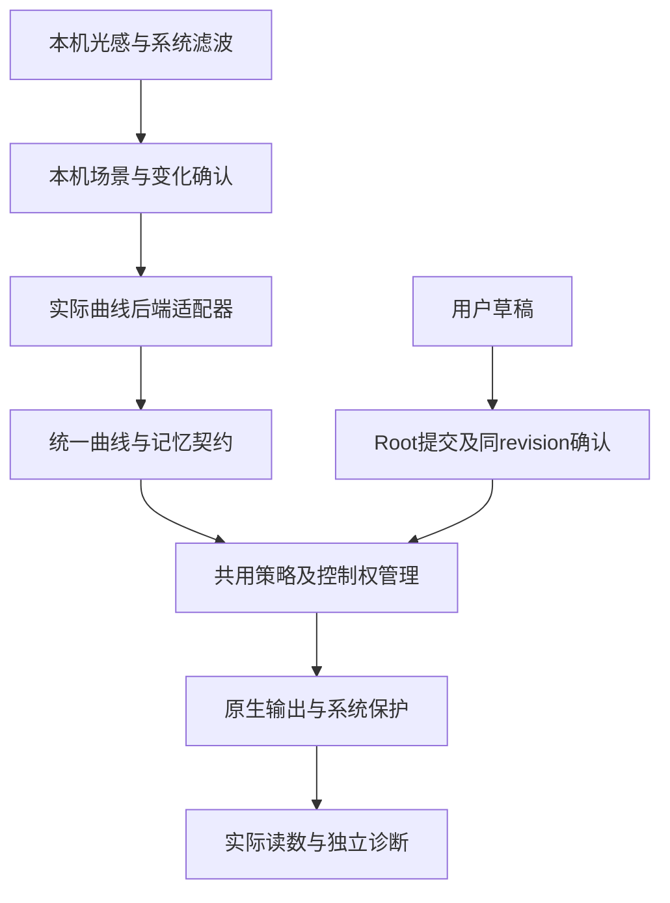

# HyperLux 项目需求与技术设计

本文是稳定的项目设计入口，不承载逐版本日志。长期约束见 [全局规则](GLOBAL_RULES.md)；当前任务见 [工作状态](docs/work-status.md)；版本变化仅见 [发布记录](docs/releases/)。

## 定位和目标

HyperLux是兼容HyperOS亮度链路的个性化工具，采用Root与LSPosed。使用设备自身曲线、输入、场景和输出机制，允许用户调整个人偏好；不提供统一机型亮度模板，不把其他设备配置当作本机标定。

包名为 `top.rongshangs.lumacurve`。当前生产源码入口是 `experimental/refactor_hook/`，历史目录名不代表实验状态。稳定的能力边界以实际代码和自动生成的功能文档为准。

## 按功能维护需求

[功能需求目录](docs/features/README.md)覆盖全部运行自检功能和界面工具。每组页面包含默认行为、触发、作用、退出、配置键、依赖能力、兼容分叉、统一输出、实现和验证入口。

- 曲线与记忆：[基础与手动记忆](docs/features/curve.md)。蓝色为基础、绿色为真实学习曲线；完整记忆可按能力转存基础。深浅色独立基础曲线和记忆处理可选，最高编辑点可向下调整。
- 光感与场景：[主输入](docs/features/main_input.md)、[辅助输入](docs/features/assist_input.md)、[系统场景](docs/features/scenes.md)。支持单源、双源及已验证私有/FOV输入；只定制已有系统场景。
- 响应与暗光：[变化确认与稳定](docs/features/response.md)、[亮度过渡](docs/features/animation.md)、[暗光锁定](docs/features/dark_lock.md)、[日落准入](docs/features/dark_lock_schedule.md)、[DIM/AOD协调](docs/features/dim_aod.md)。
- 输出范围：[户外目标](docs/features/outdoor.md)、[HBM](docs/features/hbm.md)、[高亮范围](docs/features/range.md)、[SDR限亮](docs/features/sdr.md)、[温控](docs/features/thermal.md)。各项能力分别判断。
- 节点控制：[输出租约](docs/features/raw_output.md)、[实际节点发现](docs/features/node.md)、[控制中心](docs/features/control_center.md)、[开机恢复](docs/features/mapping_startup.md)。手动面板与映射共用保持程序。
- 应用行为：[暂停自动亮度名单](docs/features/applications.md)与[应用亮度隔离](docs/features/app_brightness_isolation.md)分别处理可见性暂停和应用窗口同步。
- 工具与交互：[Root桥](docs/features/root_tools.md)、[APP工具](docs/features/app_tools.md)、[界面需求](docs/features/interface.md)。包括快速设置、教程、搜索、诊断分享、更新提示及关于页。

需求的唯一可编辑结构源是 `docs/requirements/feature-requirements.json`。文档中的兼容路线从生产目录与兼容清单组合生成；需求改变要编辑需求源，不能只修改版本日志或手改生成页面。

## 默认行为与配置语义

基础曲线未修改时沿用本机基准，手动记忆强度默认100%，保留原生学习。额外保持、暗光稳定/锁定、户外增强、温控放宽、应用隔离和节点映射均不因新安装而主动启用；允许用户打开手动节点面板不代表已开始保持亮度。

默认值只用于新配置和缺失字段。升级后的显式选择保留；能力缺失只裁剪本次运行副本，不改原文。具体功能默认与依赖记录在对应功能文档，本文不维护第二套参数表。

## 系统与模块的分工



模块调整经过确认的基线、偏好和参数，普通输出继续经过原机确认、动画及保护。直接节点控制是单独启用的租约路径，不能按普通自动亮度处理；其亮度不保证与框架目标一致。

## 兼容分叉和统一契约

[收束规范](docs/architecture/compatibility-convergence.md)定义差异边界，[路线索引](docs/architecture/compatibility-index.md)提供导航；具体选择条件和验证责任在对应功能页面。

`CurveBackendFactory`按真实活动对象选择一个后端。锚点、独立默认系数和原生重建系数Refactor，两种物理映射及标定端点变体，Simple比例映射在适配器内分叉，然后输出 `CurveBackend` 能力与 `curve_contract`。共用绘图、配置和记忆管理不再按具体适配器类型选行为。

统一契约表达坐标、插值、实际曲线可用性、学习容量、保存及回放能力、原生Hook装配、作用域和清理。不强行把框架比例变为nit：普通手动亮度100%仅是显示标尺，全域和旧存档含义保留。

HBM控制器与计时是两个维度；无HBM数据的普通范围目标增强不代表HBM范围或预算可调。nit标定失败不拖停已验证的比例/节点读数或独立控制中心坐标。

## 配置、控制权和生命周期

- APP草稿、持久化原文、能力裁剪副本与实际运行快照分开。配置提交按revision确认，失败恢复此前配置并保留草稿。
- `Settings.Global`运行配置schema与导出文件schema是不同协议；字段名中历史的nit/test等字样不构成单位或版本结论，不为整理随意改键。
- 记忆存档按设备基准、后端、用户和主题隔离。原生载荷只由对应适配器读写；独立深浅色记忆各自清除和转存。
- 控制中心、磁贴、暗光锁定、应用暂停、户外节点保持使用明确控制权和代次，不能同时争写。锁屏映射回原生；重新开启自动亮度解除手动节点保持。
- 显示链路操作留在已核验的显示线程；Root、文件与大状态写入离开该线程。回调、任务与租约均有退出清理，优先事件触发和有界重试。

## 工程结构

| 位置 | 内容 |
| --- | --- |
| `experimental/refactor_hook/java/` | APP、legacy Hook、适配器、控制器、配置、策略和诊断 |
| `experimental/refactor_hook/native/` | 受管主屏节点程序和协议 |
| `tools/build_refactor_hook_test.py` | 生产编译、完整检查、签名与不可覆盖交付 |
| `tests/` | 旧/新/负向主机回归及可选私有固件核验入口 |
| `docs/requirements/` | 唯一结构化功能需求 |
| `docs/features/` | 自动生成的按功能需求与兼容契约 |
| `docs/architecture/` | 结构、兼容规则和机器清单 |
| `docs/releases/`、`docs/reviews/` | 版本变化、专项审阅与验证证据 |
| `website/` | 官网、更新说明和在线感谢名单 |
| `build/`、`dist/` | 忽略的本地验证及交付，不作为需求依据 |

全部生产文件职责由 `source-map.json` 登记；[架构文档](docs/architecture/architecture.md)解释分层。旧KSU/C、API102、official_curve和uevent研究由任务边界隔离。

## 维护方式

```text
python tools/verify_compatibility.py --write-doc
python tools/verify_compatibility.py
python tests/refactor_compatibility_contract.py
python tools/build_refactor_hook_test.py --verify-only
```

第一项生成文档；第二项拒绝目录、配置键、实现指纹和生成页面漂移；其余验证契约及实现。自动检查不能证明所有原生语义或观感，实际验证级别见复审记录。包内必须包含规则、需求源、功能文档、实现与测试，使接手者能完整追溯。
