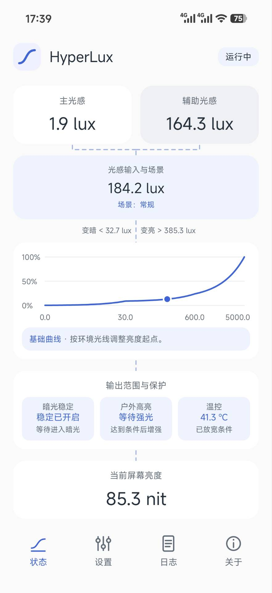
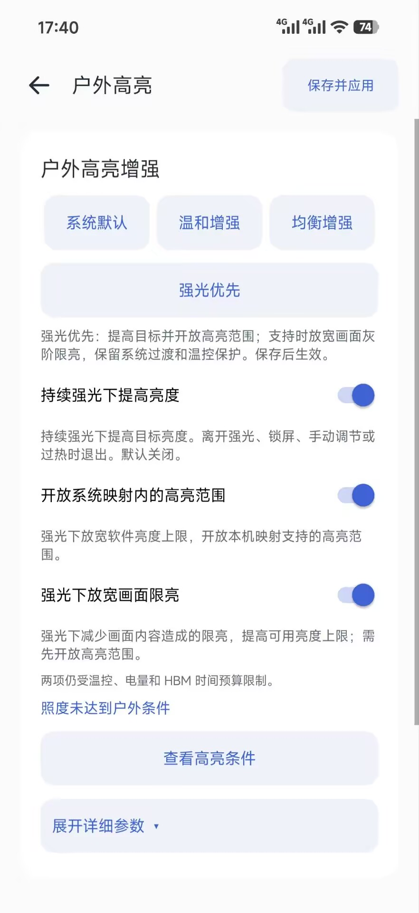

# HyperLux

**HyperOS 亮度个性化工具 · 4.3.0 正式版 / 43000**

基于 Root 与 LSPosed，在系统亮度链路内调整基础曲线、手动偏好记忆、现有场景与输出范围，保留系统过渡和保护。GPL-3.0，官方版本完全开源免费。

[官网与下载](https://lc.rongshangs.top) · [GitHub Release](https://github.com/RongShangs/LumaCurve/releases/latest) · [LSPosed](https://github.com/Xposed-Modules-Repo/top.rongshangs.lumacurve) · [作者博客](https://rongshangs.top)

## 当前版本

**4.3.0 / 43000**，相较公开4.2.0累计更新：

1. 新增控制中心节点控制：亮度条可按设备真实节点调节，支持完整控制、分区增强和自定义增强上限。
2. 新增深色模式独立亮度曲线，可分别调整深浅色模式的亮度。
3. 完善部分平板亮度曲线与控制中心映射兼容。
4. 修复部分设备熄屏前亮度反复变亮、变暗的问题。
5. 新增“恢复系统默认”，方便撤销亮度定制。
6. 优化控制中心操作示意、二级页面沉浸及关于页按钮对齐。

[本版更新日志](docs/releases/4.3.0.md) · [本版复审](docs/reviews/review-4.3.0.md) · [默认行为约定](docs/guides/default-behavior.md)

当前产品使用legacy Xposed API 82，安装和更新系统Hook仍需重启。控制中心节点控制默认关闭，需Root节点权限及“系统界面”作用域。功能以本机实际接口自检为准，主机/固件静态核对不代表全部设备实测。

后续维护遵循 [统一兼容规范与完整索引](docs/architecture/README.md)，全项目架构审阅见 [审阅记录](docs/reviews/architecture-review-20261018.md)。

## 安装

面向 HyperOS 亮度框架，最低 Android 14，需要 Root 和 LSPosed。安装 HyperLux-4.3.0.apk，在 LSPosed 启用模块、作用域选择“系统框架 / Android 系统”，重启后打开 APP 授予 Root。后续修改设置不需要重启；更新模块后需重启加载新 Hook。其他亮度模块请先停用，避免同时控制。

完整 ZIP 是 APK、对应源码与恢复工具合集，不是 KSU 刷入模块。恢复可用设置内“恢复系统默认”，或在 LSPosed 停用并重启。

## 功能

- 六题可选快速设置，确认后统一应用，不选项目保留原设置。
- 基础曲线编辑、预设及手动偏好记忆；实际绿色曲线可保存为蓝色基础。
- 主辅光感、当前场景、生效曲线、输出保护与实际亮度状态。
- 暗光稳定、暗光锁定与可选显示层温控调整。
- 户外增强、独立 nit 上限和按真实节点范围设置的可选节点增强。
- 现有场景的进入、效果、退出配置；多窗口可见应用自动亮度名单。
- 主屏手动亮度磁贴、控制中心完整/分区节点控制、配置备份、隐藏桌面图标与分析包导出。
- 可选深色模式独立基础曲线；切换主题清除对应手动记忆，设置处有提示。

详细行为及当前默认值见 [使用与机制](docs/guides/usage.md)。设备实际接口决定可用功能，不承诺所有机型相同亮度。

## 界面预览

<table><tr><th>状态</th><th>场景控制</th><th>户外高亮</th></tr><tr><td></td><td></td><td></td></tr></table>

截图为 3.0.0 的界面示例，当前功能以设置和发布说明为准。

## 开发入口

- [详细项目文档](PROJECT.md)：需求、技术路线、亮度机制、实现、协议与验证边界。
- [当前交接](AGENT_HANDOFF.md)：已发布状态、回执及未完成验证。
- [任务边界](PROJECT_SCOPE.md)：产品主线、历史路线和独立研究。
- [开发与构建](docs/guides/development.md)：工具链、验证、打包与签名。
- [文档导航](docs/README.md)：现行说明、发布记录、复审和归档。

当前源码在 experimental/refactor_hook/，当前构建入口是 tools/build_refactor_hook_test.py。module/、csrc/ 和根 CMakeLists.txt 属于历史 KSU/C 路线。

## 反馈、许可与感谢

异常请从日志页导出分析包，附机型、系统/模块版本及时间；设备资料建议私下提供。交流群 **314981836**，暗号 **1691**。

遵循 [GPL-3.0](LICENSE)，来源记录保留在 [来源与许可证](docs/来源与许可证.md)。作者：[戎Shang](https://rongshangs.top) · [酷安@戎Shangs](https://www.coolapk.com/u/3261403)。打赏自愿，不影响功能。

感谢名单的唯一数据源是 [website/thanks.json](website/thanks.json)，官网与 APP 共用；日常更新无需重新发布 APK，具体规则见 [发布约定](docs/release-policy.md)。

本项目与小米、红米、HyperOS 官方无关联。
