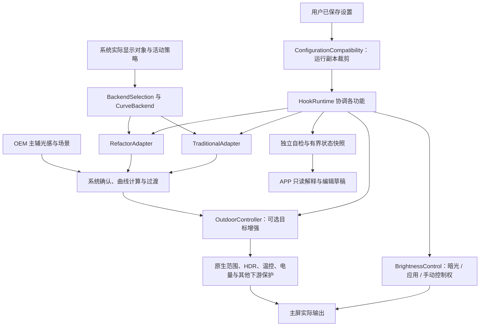

# 架构与模块边界

## 当前主线与历史隔离

`experimental/refactor_hook/` 是当前唯一 APP、Hook 与主屏原生工具主线；目录名是历史遗留，不代表实验版。`LegacyEntry` 使用 legacy API 82，通过模块自有 `hooking` 桥接层安装回调。API 102 研究、旧 KSU/C、official_curve 和 uevent 研究不自动加入主线。

主线全量验证入口为 `tools/build_refactor_hook_test.py`。工作区保留、原被 Git 忽略的 `.github/workflows/release.yml` 如果启用，会在 `v*` 标签上构建并发布历史 KSU 产物；本轮将其改为手动、只读权限的历史检查。它不代表远端正在运行错误发布器，也不能当作当前 APK 发布入口。兼容维护 CI 已准备为可跟踪文件，推送后才生效。实际发布仍遵循 [发布规范](../release-policy.md)，需要同步官网及各仓库。

## 亮度数据与控制流

上述箭头表示职责和数据方向，不表示 Hook 可越过下游限制。节点输出是单独授权的主屏租约路径，由 `BrightnessControl`、`OutdoorNodeBridge`、Root 桥及原生程序共同约束；不能把节点值当作物理 nit。

## 职责分层

| 层 | 主要入口 | 职责与边界 |
| --- | --- | --- |
| 入口 | LegacyEntry、HookEntry | 核验系统进程、有限查找实际类加载器、安装独立功能、连接主屏实例；不堆放机型名单 |
| 运行协调 | HookRuntime | 生命周期、用户与配置应用、自检触发、控制者连接、状态发布；新功能细节放入自己的适配器 / 控制器 |
| 原生适配 | RefactorAdapter、TraditionalAdapter、ResponseTuning、HbmAccess、OutdoorSdrScope 等 | 自己核验完整 ABI、选择互斥路径、守住线程 / 对象 / 下游保护、提供证据及恢复；不依赖 APP 页面 |
| 业务控制 | BrightnessControl、OutdoorController、SceneController、MemoryPersistence | 仲裁进入、持续、退出，管理租约与本次状态；不为新机型复制第二套控制状态机 |
| 配置 | 各 Options、ConfigurationFile、ConfigurationCompatibility | 解析和验证原始偏好；运行能力裁剪只作用于深拷贝，不能写回默认 |
| 策略算子 | CurvePlan、DelayPolicy、DarkLockPolicy、OutdoorPolicy 等 | 独立计算及范围约束；纯计算模块尽量不接触 Android 或反射，已有配套证据算子单独标注归属 |
| Root / 原生桥 | RootControl、NativePanelRoot、PanelNodeDiscovery | 有界提交、实际节点验证、资产校验、租约控制；配置读取与自检不启动亮度写入器 |
| 诊断 | RuntimeFeatureChecks、RootFeatureChecks、FeatureSelfCheck、DeferredStateWriter | 独立结果、固定时间、有界记录；不借检测试调亮度或建立兼容路线 |
| APP 展示 | MainActivity、FeatureCompatibility、FeatureCheckPage、CompatibilityCatalog | 编辑草稿与解释实际证据；目录不得反过来选择或启用运行路径 |
| 框架桥 | hooking/XposedBridge、HookTransaction | 回调与句柄所有权、原方法调用、必需 Hook 成组回滚；不内置机型语义 |

全部生产文件逐一登记于 [源码职责索引](compatibility-index.md#源码职责索引)。新文件或新的跨层依赖需要同步登记并通过维护检查。现有同包类保持包名和入口稳定；不为目录美观一次性挪动所有 Android 类。

## 五个执行阶段

1. **发现**：只寻找当前设备真实类、加载器、主屏与用户，不根据营销型号或 HyperOS 大版本选择功能。
2. **安装**：同一必需安装单元使用事务，全部成功后发布支持状态；可选观测、峰值与动态范围独立隔离。不能把失败到一半的回调留下后再继续另一条路线。
3. **检测**：读取安装结果和实际运行对象。自检不安装 Hook、不写亮度、不改变偏好；缺对象可以等待就绪，缺 ABI 报不支持，缺证据报未确认。
4. **应用 / 执行**：解析用户原设置，按能力得到运行副本；只在匹配对象、显示线程、用户、自动模式和功能资格下操作。
5. **退出**：停用、屏幕 / 用户 / 对象变化、故障与租约到期时归还本次控制权，只恢复仍由本次持有的值。

## 线程、资源与时间

- 显示线程和 WM 锁回调不进行 Root、阻塞任务查询、同步完整诊断或长耗时文件操作。
- WM 只读取不可变身份并投递；可见任务查询复用有界惰性工作线程，过期代次丢弃，不新增轮询进程。
- 状态写入合并为最新完整快照，分片最后发布 manifest；读取不能跨快照拼接旧分片。
- OEM 主辅采样保持原职责。暗光锁定的低频退出监听为独立路径；on-change 与连续采样的新鲜度规则分别处理。
- 原生节点验证真实路径、主屏身份和亮度配对，锁定文件及 IPC 调用者身份；短租约失联退出，系统已改写的亮度不强制覆盖。

## 复杂度控制

后续新需求先找到现有职责层：数值算法进 Policy，ABI 选择进该功能适配器，运行归属进既有控制器，编辑交互进页面类。不能在 MainActivity、RootControl、HookRuntime 各新增一份互不知情的机型判断。

MainActivity 与 HookRuntime 仍是较大的协调类。本轮不改需求、不批量改名、不重写成熟状态机；新功能禁止继续向其塞反射和兼容分支。需要拆页面或控制器时，应按一个边界一个变更、有旧行为回归的方式进行，而不是一次性改动所有适配路径。
