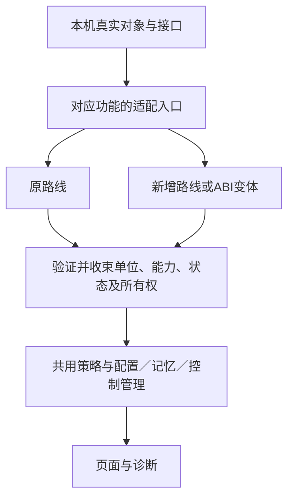

# 兼容分叉与收束规范

适用当前主线全部兼容组。最高要求仍是保留已有路线、覆盖升级保留全部已保存设置。具体分叉和收束位置登记在 `compatibility-manifest.json` 的 `convergence`，生成到 [对应功能页](../features/README.md)，不得只写在某一次复审记录里。

## 统一原则

设备差异在确实不同的接口、对象或坐标处进入适配器；在进入共用管理流程之前，提供一致的操作、数据语义和能力结果。页面、配置、记忆管理和运行协调不各自根据型号、版本、原生字段或后端名字再选一次路线。

不是把所有数字硬转成同一种物理量。逻辑 nit、物理 nit、framework brightness、物理背光和节点整数有不同含义；必须先注明坐标并在有验证依据的边界转换。没有可验证换算时返回未确认，不能把数值直接当作另一种单位。

## 每组必须登记的内容

- `boundary`：处理实际 ABI 差异并提供统一结果的生产文件，必须属于该兼容组的实现者。
- `contract`：共同消费者实际使用的操作、数据或状态契约；不能只写“兼容处理”。
- `coordinates`：单位、时间基准、身份、未知状态及原生数据保留规则。
- `consumers`：收束后的共同消费者；新增路线原则上不要求这些消费者增加设备分支。

功能路线、路线内部 ABI、Root 权限和系统运行状态分开。目录可写不等于启动脚本实际执行，接口存在不等于功能启用，当前没采样不等于 0 lux。可选能力失败不回写用户原配置，也不拖停独立功能。

## 曲线的实际边界

`CurveBackendFactory` 只按已经选择的实际控制对象构造后端，读取本机边界。`RefactorProfiles` 保持锚点／系数的完整 ABI 验证和拒绝残缺接口规则。`TraditionalAdapter` 保留小米及 AOSP 物理映射、标定端点适配和原始曲线恢复。`SimpleCurveAdapter` 仅接实际Simple对象，保留原始数组与原生学习，通过完整比例节点重建基线，不要求不存在的物理nit标定。

Refactor独立默认字段/消费者整体缺失时，`RefactorResetAdapter`可在完整原生重建、私有当前消费者和9/22状态布局下读取基线。基线探测使用同步事务快照，退出恢复数组身份、内容及学习标记；不把当前学习结果当默认，也不伪造缺失字段。默认接口残缺仍拒绝，新路线不替换原路线。私有当前消费者的末段约束通过`currentInputLux`能力方法收束，其余原生换算和高光保护继续执行。

各后端通过 `CurveBackend` 提供坐标、插值类型、可保存点数、当前模型归属、模型恢复是否已经同步以及可观察的交接对象。原生映射Hook通过`installMappingHooks`由后端自行装配；公共启动入口不再用具体类型猜配置Hook。`manualPointCapacity`只表达可观察原生学习容量，`persistentMemorySupported`独立校验存档回放接口；不能用回放缺失否定现有学习。共用接口默认不读取 Refactor 锚点，也不默认支持保存。`HookRuntime` 负责调度与事务，不根据后端名字推测上述能力。Simple首次提交时的临时用户许可仅在同步适配器事务内存在；退出或异常立即清理，不提前绑定公共运行用户。

运行快照新增 `curve_contract` v1，包含坐标、插值、严格递增要求、当前曲线可用性、记忆描述、实时点数、保存能力和容量。`CurveCompatibility` 是读取边界：

1. 有新契约：严格校验版本、数值类型、能力和坐标；无效时拒绝，不能退回旧字段绕过校验。
2. 没有新契约：集中读取原有快照。传统曲线的完整基线和重塑、旧式系数约束、原路线生效条件全部保留在此处。
3. 向 `CurveComparison` 输出共同的参考／已应用／当前曲线。参考与应用曲线保持各自数据集；没有实时曲线时不拿存档或拟合结果冒充。
4. 向页面提供编辑约束、记忆说明与点数，向 `SavedCurve` 提供可转存曲线及容量。页面和配置对象不再各做一次后端判断。

`CurveDisplayRange` 仍在设备边界核验普通手动滑条上限及其换算。所有图形和百分比输入以同一普通手动上限为 100%，但不改全设备存储／输出域；原有高亮点保持可表达，允许数值超过普通手动 100%。实际标尺暂缺时沿用原域并记录依据，不捏造跨单位转换。

## 记忆与配置

实时记忆的 `display_nit` 由后端转换到与图形一致的坐标。原生手动点 `value` 在持久化层是只经后端读写的载荷：传统映射使用 framework brightness，Refactor 使用逻辑 nit。旧存档的 schema、数值与作用域身份不改，不能为了统一展示而重写已有记录。作用域仍核验后端、基准、用户和主题。

`MemoryPersistence` 只调能力接口和统一的读取／恢复操作。传统后端用原生用户亮度入口恢复时已同步短期模型；锚点后端需要独立模型同步；系数路线未经验证的恢复仍不可用。原生观察适配器 `MemoryLifecycle` 提供交接事件和模型快照，不在管理器中复制其反射逻辑。实时记忆与归档分开读取，坏存档不得让实时点数消失，也不自动清空存档。

`ConfigurationCompatibility`、`ConfigurationFile` 的后端／基准比较用于识别配置归属，不是选择设备路线，继续保留。`ThemeCurveOptions` 读取统一能力校验保存曲线；历史字符串验证入口委托同一个兼容边界，供旧配置消费者保留。

## 启动恢复及其他功能

Android 任务与 Root service.d 是两个入口，统一调用 `mappingRecoveryWanted` 和 `ControlCenterRoot.recover`。两者都重新核验本次 boot、进程、revision 和节点所有权；不回放历史亮度与手势。Root 执行证据区分本次与历史启动，包路径读取和恢复命令都有限时。

其余光感、场景、HBM、SDR、节点、应用隔离、Root 工具等的实际边界逐组见索引。HBM 控制器 ABI 与预算 ABI 允许独立组合；Root 权限与框架注入独立；节点读回先绑定当前物理屏再换算。统一的是这些功能各自的语义，不能把不同控制权强行合为一个兼容开关。

## 后续新增路线的步骤

先确定哪项接口或坐标确实不同 → 在对应边界新增路径 → 输出既有契约 → 走原共用管理流程。若现有契约不能表达新能力，增加语义字段并明确旧格式规则，而不是给 UI 和管理器各加一个后端分支。

登记路线／ABI 与上述四项收束说明，补旧／新／同时存在／残缺／异常／跨代／保存设置回归，然后生成索引、检查边界约束并完整构建。契约检查会拒绝共用曲线消费者重新出现指定原生分支，也会拒绝收束登记缺失；它不能证明所有原生语义正确，仍需审阅。

## 其他功能和历史边界

每个兼容组的具体契约、分叉、坐标、能力与验证入口见[功能目录](../features/README.md)，此处不复制整套路线。稳定ID、未采用路径及组合方式由同一清单生成，界面目录不参与选路。

当前屏幕输出通过ScreenBrightnessReading统一选择已核验nit、真实节点或普通框架实际比例；raw接管不能复用旧框架比例。可选遥测的类加载/换算失败与基础状态、控制中心坐标分开，不因可选失败切换主能力路线。

历史原生状态采集仍有部分在HookRuntime.collectOfficial/collectScenes；SceneController也仍读取已注册系统事实。这些是明确的组织债务，不能宣称所有历史反射已搬空；后续拆分需保留真实字段、调用顺序及旧回归，不机械重写成熟Hook。曲线后端get(name)还承担有限规范化状态门面，新增差异优先提供语义能力方法，不能将原生字段继续扩散到共用策略。

## 构建约束和文档对应

保护的功能/路线组合与测试入口数量从清单计算，不在稳定规范里维护另一套版本数字。任意旧组合被删除、功能需求缺失、配置键不存在、实现未登记或生成页面/源码指纹过期，均应使普通检查失败。

边界检查根据实际CurveBackend子类及路线身份建立负向约束，包含后来加入的Simple；不能只禁止最早的TraditionalAdapter。检查允许配置归属比较，禁止UI或共用管理据具体类重新选择行为。

需求在结构化JSON维护，系统场景说明可按稳定场景ID引用生产常量。修改实现或需求后生成文档并查看差异，不把手工同步声明当作自动证明。自动检查保障结构和追溯，语义审阅、真机与功耗验证仍需各自证据。
